# EasyGit

<p align="center">
  <b>不用记一条命令，也能放心用 Git。</b><br>
  <sub>轻量 · 跨平台 · 中文优先的开源 Git 可视化桌面应用</sub>
</p>

<p align="center">
  <a href="src-tauri/Cargo.toml"></a>
  <a href="LICENSE"></a>
  
  
  
  
</p>

<p align="center">
  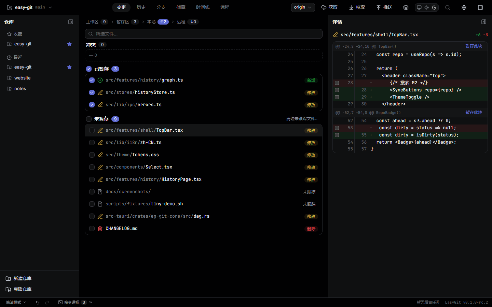
</p>

EasyGit 把 Git 的全部常用操作搬进一个中文界面的桌面应用：勾选文件即暂存、在 diff 里逐块提交、用一张提交历史图看清分支来去、冲突逐块点选——**每个动作都会展示等价的 git 命令**，边用边学。对熟练开发者，它同样是一个不打断手感的专业客户端。

> **项目状态**：`0.1.0-rc.3`（Windows 公测 / Linux deb·rpm·AppImage 出包）。M1 功能面已闭合，M2/M3 计划中。
> 安装包**尚未代码签名**，首次运行可能会遇到 SmartScreen / Gatekeeper 提示（见[已知限制](#已知限制)）。

---

## 目录

- [为什么会有 EasyGit](#为什么会有-easygit)
- [界面速览](#界面速览)
- [核心能力](#核心能力)
- [安全网：破坏性操作永远可撤销](#安全网破坏性操作永远可撤销)
- [技术架构](#技术架构)
- [快速开始](#快速开始)
- [性能](#性能)
- [路线图与非目标](#路线图与非目标)
- [文档索引](#文档索引)
- [参与贡献](#参与贡献)
- [已知限制](#已知限制)
- [License](#license)

---

## 为什么会有 EasyGit

Git 是版本控制的事实标准，但它对新手并不友好：172 个子命令、暂存区/HEAD/分离头指针等隐式概念，加上 `reset --hard`、`push --force` 这类一按就丢工作的操作。现有图形客户端要么功能缺斤少两，要么中文术语水土不服，要么体积和内存明显偏重。

EasyGit 的取舍很明确：

- **零命令行完成日常 Git**：克隆、暂存、提交、分支、合并、推送全部图形化，不需要记任何命令。
- **每一步都看得见**：命令透视实时展示等价 git 命令（只读、可复制），把 GUI 当作 Git 的学习脚手架。
- **不会丢东西**：破坏性操作先自动快照，删除进回收站，操作时间线一键回到任意状态。
- **小、快、省**：Tauri 2 + Rust 内核，不带 Chromium/Node 运行时；本地 deb 安装包 ≈ 7.3 MB，冷启动 ≈ 0.5 s。

## 界面速览

| <a href="docs/screenshots/history.png">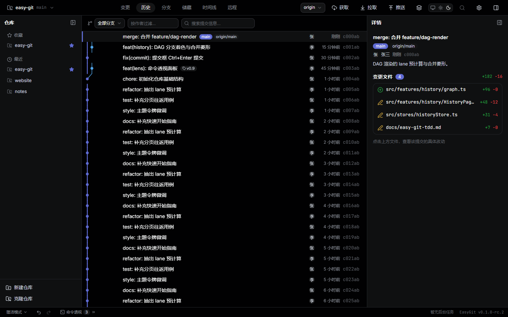</a> | <a href="docs/screenshots/history-diff.png">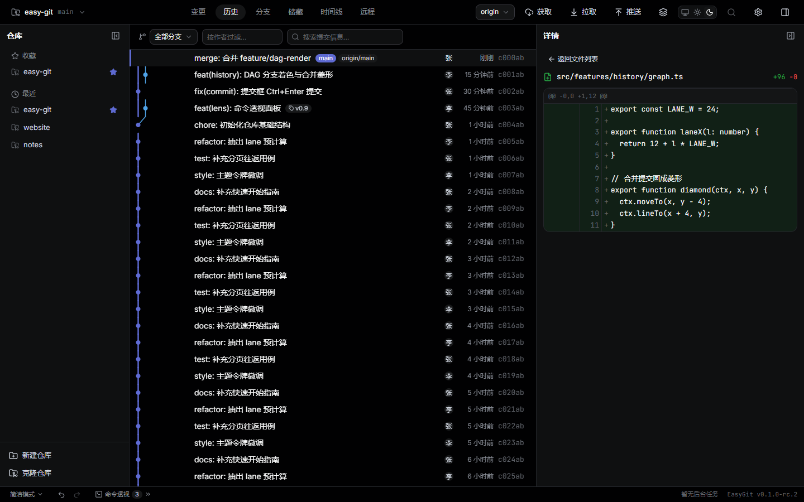</a> |
| --- | --- |
| <sub>提交历史：分支分道着色、合并菱形，按分支 / 作者过滤</sub> | <sub>提交详情：变更文件列表，点文件即看该提交的只读 diff</sub> |

| <a href="docs/screenshots/conflict.png">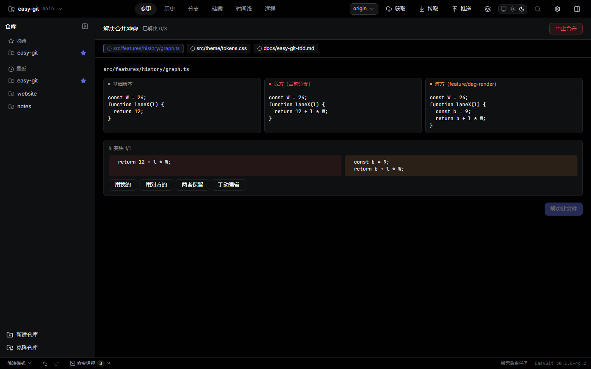</a> | <a href="docs/screenshots/commit.png">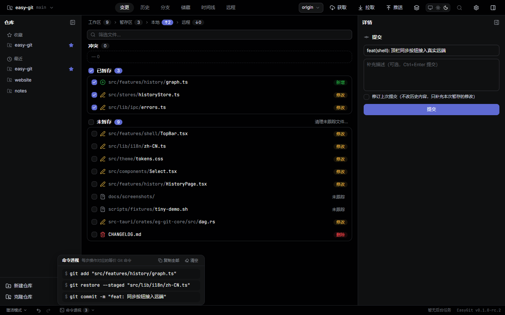</a> |
| --- | --- |
| <sub>冲突向导：基础版本 / 我方 / 对方三栏对照，逐块选择后完成合并</sub> | <sub>提交框 + 命令透视：每步操作对应的等价 git 命令，可一键复制</sub> |

| <a href="docs/screenshots/branches.png">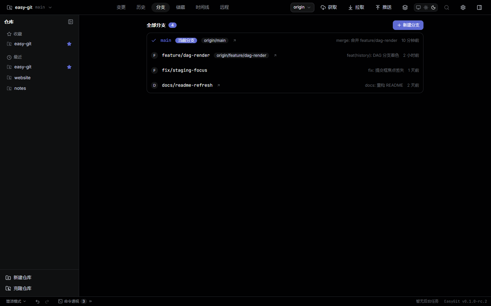</a> | <a href="docs/screenshots/storage.png">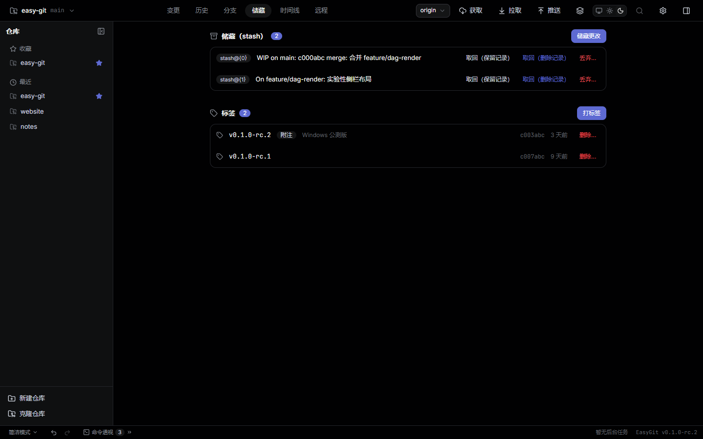</a> |
| --- | --- |
| <sub>分支看板：当前分支置顶，领先/落后与上游跟踪一眼可见</sub> | <sub>储藏与标签：WIP 快照与发布标签集中管理</sub> |

| <a href="docs/screenshots/remotes.png">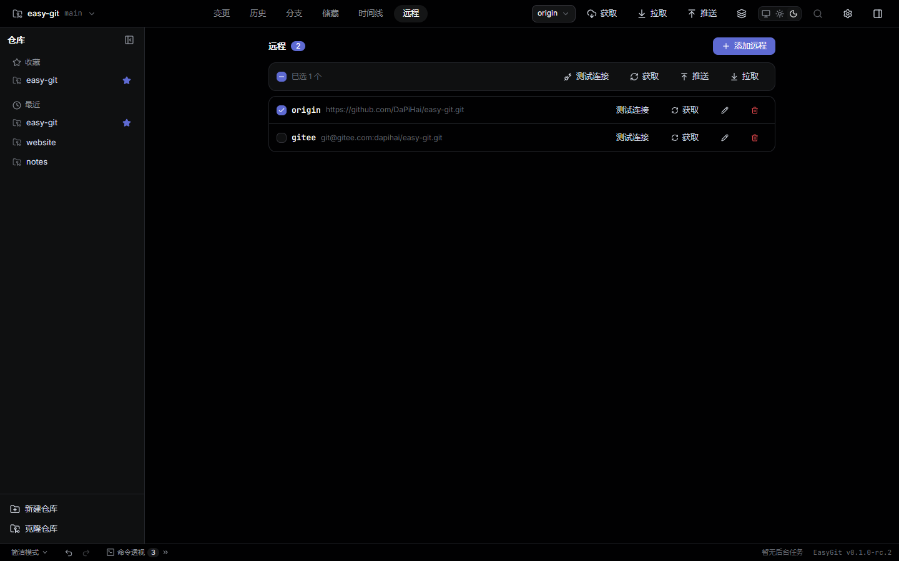</a> | <a href="docs/screenshots/timeline.png">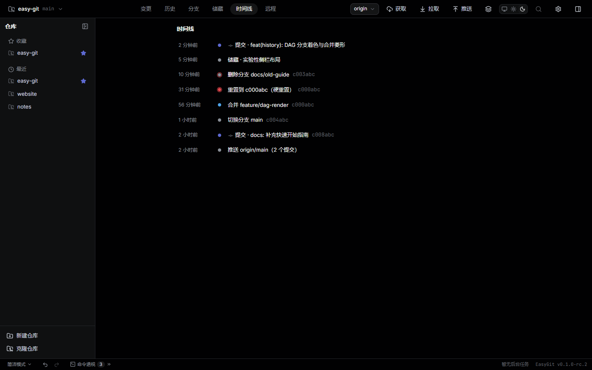</a> |
| --- | --- |
| <sub>远程管理：勾选远端批量测试 / 获取 / 推送，拉取一次只允许一个远端</sub> | <sub>操作时间线：reflog 与操作日志合并，危险操作带红环标记</sub> |

<p align="center">
  <a href="docs/screenshots/changes-light.png">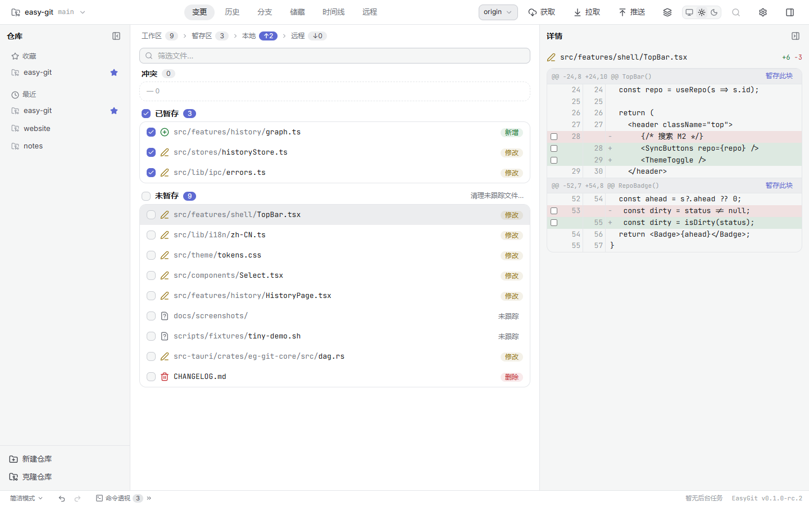</a><br>
  <sub>同一套语义令牌驱动的亮色主题，全界面覆盖</sub>
</p>

> 明暗双主题、跟随系统；全部界面文案中文，术语遵循统一词汇表（stash = 储藏、fetch = 获取、pull = 拉取）。
> 截图取自 `pnpm dev` 预览环境（1440×900），使用演示仓库数据。

## 核心能力

状态口径：**已实现** = 已进代码并有测试；**部分** = 只覆盖部分场景；**计划** = 仅规划，未实现。

### 仓库与工作区

| 能力 | 说明 | 状态 |
| --- | --- | --- |
| 打开 / 新建 / 克隆仓库 | 已是仓库的目录幂等当打开，空目录一键 `git init`；克隆带进度 | 已实现 |
| 多仓库工作台 | 侧栏收藏与最近打开，`Ctrl+K` 快速切换 | 已实现 |
| SSH 远端仓库 | 直接打开服务器上的仓库，无需克隆到本地（危险写入默认禁用） | 已实现 |
| 三区状态视图 | 冲突 / 已暂存 / 未暂存（含未跟踪、整目录折叠），四站流转指示 | 已实现 |
| 勾选式暂存 | 勾文件即入暂存区，区头可整区批量操作 | 已实现 |
| 逐块 / 逐行暂存 | 在 diff 里只暂存选中的 hunk 或行，可反向取消（`git apply --cached`） | 已实现 |
| 丢弃 / 清理 | 丢弃前自动快照；清理未跟踪先预览再确认 | 已实现 |
| `.gitignore` 生成 | 右键忽略路径，缺省可生成通用模板 | 已实现 |
| 环境自检 | 启动探测系统 git，缺失或低于 2.30 时挡主界面并引导安装 | 已实现 |

### 提交与历史

| 能力 | 说明 | 状态 |
| --- | --- | --- |
| 提交 / 修正上一次提交 | 主题 + 正文、校验、`Ctrl+Enter` 提交、缺身份提示 | 已实现 |
| 提交历史 DAG | 分支分道着色、合并菱形、`canvas` + 窗口化虚拟滚动、每页 500 条续读 | 已实现 |
| 过滤与搜索 | 按分支 / 作者过滤，按提交信息搜索 | 已实现 |
| 提交详情 | 元信息、引用标注、变更文件列表，点文件看该提交的只读 diff | 已实现 |
| Diff 视图 | 行级与词级高亮、二进制识别、超长文件折叠 | 已实现 |
| 回滚 / 重置 | 生成反向提交；soft / mixed / hard 三模式，硬重置前先快照 | 已实现 |
| 标签管理 | 轻量 / 附注标签创建与删除（删除进回收站） | 已实现 |
| 文件历史 / blame、内容搜索 | 单文件追溯与全文检索 | 计划（M3） |

### 分支、储藏与合并

| 能力 | 说明 | 状态 |
| --- | --- | --- |
| 分支看板 | 当前分支置顶、领先落后、快速切换、右键菜单 | 已实现 |
| 分支增删改 | 任意起点新建、改名、删除进回收站、设置上游 | 已实现 |
| 切换守卫 | 有已跟踪改动先拒绝，可「储藏并切换」 | 已实现 |
| 储藏 | 保存（含未跟踪）/ 取回（保留或删除记录）/ 丢弃 | 已实现 |
| 合并 | 快进优先，可勾选「总是创建合并提交」（no-ff） | 已实现 |
| 冲突向导 | 全屏接管：三栏对照、逐块「用我的 / 用对方的 / 两者保留 / 手动编辑」、随时中止 | 已实现 |
| 变基 / 摘取提交 / 检出历史版本 | — | 计划（M2） |
| 交互式变基 / 二分定位 | — | 计划（M3） |

### 远程与同步

| 能力 | 说明 | 状态 |
| --- | --- | --- |
| 获取 / 拉取 / 推送 | 顶栏按钮组，把 `git --progress` 的 stderr 解析成底栏进度条 | 已实现 |
| 未知分叉处理 | 拉取遇分叉时弹框：合并远端提交（复用合并管线） | 已实现 |
| 强制推送与回滚 | 强推前刷新 lease 并记录远端旧 tip，撤销可推回 | 已实现 |
| 远程管理 | 增删改、连通性测试（`ls-remote`）、远程分支列表 | 已实现 |
| 多远端同步 | 勾选远端批量测试 / 获取 / 推送；拉取一次只允许一个远端 | 已实现 |
| SSH 首次连接引导 | 探测主机指纹 → 用户确认后才写 `known_hosts`，可生成 / 复制 ed25519 公钥 | 已实现 |
| 凭据 | 不接触密钥，交给系统 git 凭据助手 / ssh-agent；HTTPS 推送被拒后弹一次凭据框 | 部分 |

### 体验与平台

| 能力 | 说明 | 状态 |
| --- | --- | --- |
| 明暗双主题 | 跟随系统 / 浅色 / 深色，只用 `--eg-*` 语义令牌 | 已实现 |
| 命令透视 | 每个动作展示等价 git 命令，可复制，最多保留 100 条 | 已实现 |
| 错误人话化 | 统一错误码 → 中文标题 + 可展开原因 + 建议动作 + 日志行 | 已实现 |
| 日志查看器 | 每日滚动文件、级别过滤、打开日志目录 | 已实现 |
| 快捷键 | `Ctrl+K` 切仓库、`Ctrl+,` 设置、`Ctrl+Z/Y` 撤销重做、`Alt+1..6` 切视图 | 部分（Linux 原生层会吞 Alt/Ctrl+数字，待复验） |
| 概念卡片 | 首次打开仓库时一次性讲解暂存区 / 提交 / 分支 / 远端 | 已实现 |
| 简洁 / 专家模式 | 偏好持久化，文案与入口随模式切换 | 部分 |
| 多语言 | 目前仅 zh-CN，字符串已全部资源化 | 部分（英文包在 M3） |

## 安全网：破坏性操作永远可撤销

这是 EasyGit 与多数客户端最大的区别，也是「敢给新手用」的前提：

1. **先快照，后执行**。重置、丢弃修改、删除分支/标签等操作，在执行前把受影响内容写成无父提交，挂到 `refs/easy-git/backup/<op_id>`；快照写失败就直接中止操作。
2. **删除进回收站**。分支与标签的删除只是挪到 `refs/easy-git/trash/*`，随时找回。
3. **操作日志 append-only**。`<app-data>/safety/<repo-id>/operations.jsonl` 记录每次操作的 op_id 与结果；撤销 = 追加一条 `undone`，重做 = 重放原语并复用同一个 op_id。
4. **操作时间线**。reflog 与操作日志合并排序，危险节点带红环标记，可「恢复到此状态」。

底栏左侧的撤销/重做按钮始终可用，状态由后端 `undo_redo_state` 驱动。破坏性操作相关的每个改动都必须附带撤销/恢复测试。

## 技术架构

```
组件 → Zustand store → src/lib/ipc（唯一 IPC 封装层）→ commands.rs（薄编排）
     → eg_git_core::RepoManager → WorkerHandle → RepoWorker 线程 / ssh_backend
     → eg-git-core 领域模块 → git2-rs 或 git CLI
事件回流：repo://changed（fs-watch 300ms 防抖）、sync://progress（网络进度）→ store → 视图
```

**git 逻辑只存在于 Rust 侧**，前端是纯展示与编排；命令层只做参数搬运与 `spawn_blocking` 转发。

| crate | 职责 |
| --- | --- |
| `eg-types` | 跨 IPC 的 DTO 与统一错误 `EgError`，敏感信息脱敏 |
| `eg-git-core` | 全部 git 领域逻辑：status / stage / commit / log / diff / refs / merge / stash / remote / timeline，以及 `RepoWorker` 线程模型与 SSH 后端 |
| `eg-safety` | 安全引擎：快照点、回收站 ref、操作日志、撤销 / 重做 |
| `eg-providers` | 平台适配层（GitHub / GitLab / Gitee）——M1 只钉接口与 DTO，实现属 M2 |
| `eg-indexer` | 大仓库加速（commit-graph、拓扑 lane 缓存） |

几个关键决策：

- **Tauri 2 而非 Electron**：不捆绑 Chromium/Node，包体积与内存才可能达到 PRD 的量级目标（≤ 30 MB / 冷启动 ≤ 2 s）。
- **git2-rs + git CLI 混合**：常规读写走 libgit2（结构化、快）；行级暂存、网络操作、libgit2 覆盖不全的场景以 `git` CLI 兜底（`--progress` 流式上报）。所有外部命令经 `hidden_command` 创建，Windows release 下不会弹黑窗。
- **每仓库一个 `RepoWorker` 线程**：`git2::Repository` 非 `Sync`，用 mpsc 队列串行化，同时承载 fs-watch 与空闲 5 分钟静默 `git gc`。
- **SSH 远端是一等公民，但只读为纲**：远端仓库可浏览、可提交、可拉取；重置、强推、丢弃、删除分支/标签/储藏、撤销/重做等破坏性操作在远端一律返回 `NotSupported`。
- **IPC 类型自动生成**：`src/lib/ipc/bindings.ts` 由 tauri-specta 生成并纳入 CI 漂移检查；目前 **72 条 Tauri 命令**。

工程侧：前端 46 个测试文件 / 280 个用例（vitest），Rust 行为测试按里程碑拆成 9 个集成测试文件，CI 在 Windows / macOS / Ubuntu 三矩阵跑 lint、测试与完整出包。

## 快速开始

### 使用

1. 从 CI 构建产物（`.github/workflows/ci.yml` 的 artifacts：deb / rpm / AppImage / msi / exe / dmg）或本地 `pnpm tauri build` 取得安装包。当前唯一的 tag [`v0.1.0-rc.3`](https://github.com/DaPiHai/easy-git/tree/v0.1.0-rc.3) 标注为 Windows 公测版。
2. 确认系统已安装 **Git ≥ 2.30** 并在 `PATH` 上——EasyGit 不自带 git，启动时会自检并给出安装引导。
3. 打开 EasyGit，选择本地仓库 / 克隆 / 连 SSH 远端仓库，即可开始。

<p align="center">
  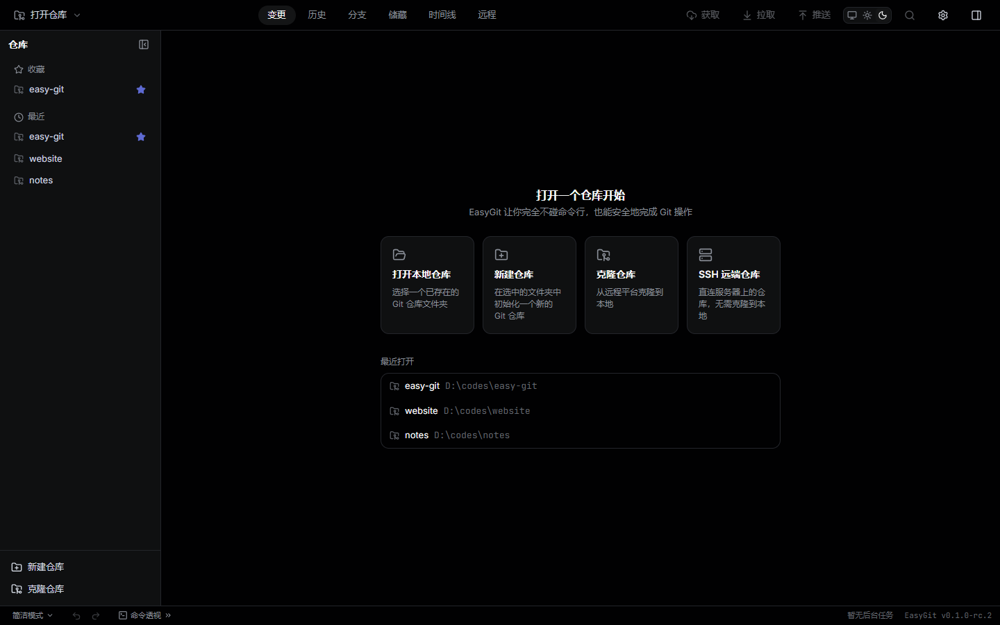
</p>

### 开发者

要求：**Node.js ≥ 20**、**pnpm 10.20.0**（见 `packageManager`）、**Rust stable ≥ 1.85**、**Git ≥ 2.30**；Linux 另需 `libwebkit2gtk-4.1-dev` 等 Tauri 依赖。

```bash
pnpm install          # 安装依赖（CI 用 --frozen-lockfile）
pnpm tauri dev        # 桌面联调
pnpm dev              # 纯前端 vite（:5173，IPC 走降级分支，用于 UI 调试/截图）
pnpm test             # 前端单测（vitest）
pnpm typecheck && pnpm lint && pnpm format:check
pnpm tauri build      # 出包 → src-tauri/target/release/bundle/
```

```bash
# src-tauri/ 下
cargo fmt --all --check
cargo test --workspace
cargo clippy -- -D warnings          # CONTRIBUTING 门槛，CI 未跑，提交前本地执行
cargo run --features gen-bindings --bin generate-bindings   # 跑完须 git diff 为空
```

> **Windows 出 MSI 的坑**：WiX 只接受纯数字版本，预发布串会被拒绝。需覆盖版本号，且每次递增 N（同号会被已装旧版拒绝覆盖）：
>
> ```bash
> pnpm tauri build --config '{"bundle":{"windows":{"wix":{"version":"0.1.0.N"}}}}'
> ```
>
> NSIS 无此限制。

想按新手视角验收？用 [10 分钟新手测试脚本](docs/testing-10min.md) 走一遍任务卡（克隆 → 改 + 提交 → 建分支 → 合并）。

## 性能

Linux（WSL2 / WSLg，6 核）deb release 构建，`mid-size` 基准仓库（5001 提交 / 51 引用），完整数据与复现方法见 [性能基线](docs/perf-baseline.md)。

| 指标 | 目标 | 实测 |
| --- | --- | --- |
| 冷启动（进程 → UI 可交互） | ≤ 2 s | **0.49 s** |
| 打开仓库 | — | 0.24 s |
| 历史首屏 500 提交（DAG + 行渲染） | ≤ 3 s | **0.43 s** |
| 安装包 | ≤ 30 MB | deb **≈ 7.3 MB**（本地 rc.2 构建；MSI 6.1 MB / NSIS 4.2 MB） |
| 空闲内存（三进程 RSS） | ≤ 300 MB | ≈ 469 MB（未达标，见[已知限制](#已知限制)） |
| 10 万提交仓库 | M3 目标 | 未实测（fixture 已就绪：`scripts/fixtures/build-fixtures.sh --huge`） |

## 路线图与非目标

| 里程碑 | 内容 | 状态 |
| --- | --- | --- |
| **M1 — 本地仓库全流程** | 多仓库、三区暂存、提交、DAG 历史、分支/标签/储藏、合并与冲突向导、推送拉取、撤销系统、时间线、自动维护、命令透视 | **已完成**，`0.1.0-rc.3` 出包；真人可用性验收待完成 |
| **M2 — 远程协作** | 变基、摘取提交、检出历史版本、远程分支管理、GitHub/GitLab/Gitee 账号与 PR/MR/Issue | 计划中 |
| **M3 — 进阶与打磨** | 交互式变基、二分定位、子模块/工作树、blame 增强、英文包、10 万提交性能达标、自动更新 | 计划中 |

**明确不做**（[PRD §1.5](docs/easy-git-prd.md)）：不内置可输入任意命令的终端（只提供只读的命令透视）、不做代码编辑器、不做 SVN/Perforce 互操作、不自建托管服务、界面不暴露 plumbing 命令。

## 文档索引

| 文档 | 说明 |
| --- | --- |
| [需求文档 PRD](docs/easy-git-prd.md) | 定位、用户与场景、功能需求（P0–P2）、里程碑与验收标准 |
| [技术架构 TDD](docs/easy-git-tdd.md) | 选型决策、crate 划分、IPC 与并发模型、安全引擎、测试与 CI |
| [UI 设计文档](docs/easy-git-ui-design.md) | 设计令牌、明暗双主题、组件规格与界面布局（Linear 设计语言） |
| [M1 开发计划](docs/easy-git-m1-plan.md) | 十周任务拆解、每周验收与裁剪顺序 |
| [Git 命令清单](docs/git-commands.md) | Git 2.53 全部 172 个命令及作用，功能覆盖映射依据 |
| [性能基线](docs/perf-baseline.md) | 冷启动、首屏、内存、包体积的实测数据与复现步骤 |
| [10 分钟新手测试](docs/testing-10min.md) | 真人验收脚本、观察记录表与自动化对照 |
| [文档索引](docs/README.md) | 全部文档与推荐阅读顺序 |

## 参与贡献

欢迎任何形式的贡献（尤其是「以新手视角挑毛病」）。开工前请先读 [CONTRIBUTING.md](CONTRIBUTING.md)：

- 分支从 `main` 切出，前缀 `feat/` `fix/` `docs/`；提交遵循 Conventional Commits（`type(scope): 中文描述`）。
- UI 改动**必须附明暗双主题截图**并对照 [UI 设计文档](docs/easy-git-ui-design.md)。
- Rust 行为改动需附带与真实 git 一致的断言测试；破坏性操作必须包含撤销/恢复测试。
- 提交前本地跑齐：`cargo fmt --all --check`、`cargo clippy -- -D warnings`、`cargo test --workspace`、`pnpm lint && pnpm typecheck && pnpm test`、绑定重生成后 `git diff --exit-code -- src/lib/ipc/bindings.ts`。

CI 在 Windows / macOS / Ubuntu 三平台跑 lint、测试与完整出包矩阵。

## 已知限制

- **安装包未签名 / 未公证**：Windows 会触发 SmartScreen（选择「仍要运行」），macOS 需在「系统设置 → 隐私与安全性」放行。签名与公证属 M3。
- **macOS 尚未真机验证出包**；Linux 的视图快捷键（Alt/Ctrl + 数字）被 WebKitGTK 原生层吞掉，待真桌面复验。
- **SSH 远端仓库默认禁用危险写**：重置、强推、丢弃、清理、删除分支/标签/储藏、撤销/重做在远端一律不可用，请在服务器上直接操作。
- **空闲内存未达 PRD 目标**（≈ 469 MB vs ≤ 300 MB）：WebKitGTK 渲染进程本身占比较大，后续会按「主进程 / 渲染进程分列口径」重新定义目标。
- **储藏丢弃不可撤销**（libgit2 无对应 API），仅以红色确认框兜底。
- 尚未提供官方 Releases 页与自动更新；M1 的真人可用性验收（5 名无 Git 经验用户）仍在组织中。

## License

[MIT](LICENSE) © 2026 The EasyGit Authors。UI 设计语言基于 [awesome-design-md](https://github.com/voltagent/awesome-design-md) 的 Linear 设计分析（MIT）适配，上游许可见 [docs/design/LICENSE.awesome-design-md](docs/design/LICENSE.awesome-design-md)。
